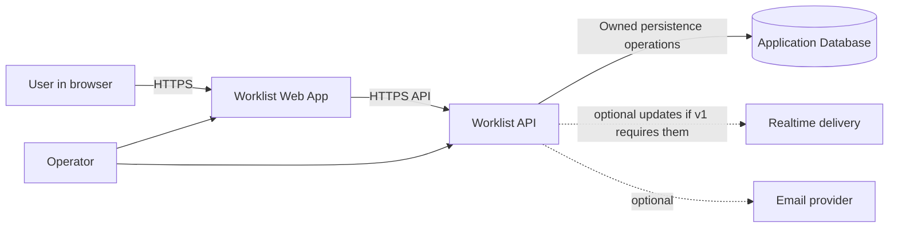

# System Context and Scope

**Version:** 0.2  
**Status:** Draft for review  
**Owner:** [Your Name]  
**Reviewer:** Adeel  
**Last Updated:** 2026-10-13  
**Related Docs:** `../product/01-vision.md`, `../product/02-problem.md`, `../product/03-goals.md`

---

## 1. Purpose

Define the Worklist system boundary, its users, the external systems it depends on, and the first-release scope before choosing detailed components.

## 2. Product Context

Worklist is proposed as a web product for creating and organizing team work items in a configurable list. Its intended differentiators are list controls such as sorting, filtering, grouping, column configuration, bulk actions, saved views, and collaboration.

The problem and target users are hypotheses from the product drafts and require validation. This document does not claim that the product is already implemented.

## 3. System Boundary

### Inside the product boundary (proposed v1)

- Web experience for authentication and list interaction.
- Application API for identity-aware item and view operations.
- Persistence for users/memberships, lists/items, and saved configurations, according to confirmed scope.
- Authorization checks at every protected data boundary.
- Optional collaborative update delivery if real-time sync is approved for v1.

### Outside the boundary / dependencies to decide

- Email delivery for verification or password recovery, if required.
- Identity provider, if external authentication is selected.
- Hosting, database service, monitoring and alerting providers.
- Browser and network behavior on user devices.

No vendor or provider is approved by this context document.

## 4. Actors

| Actor            | Goal                                  | Trust assumption                                   |
| ---------------- | ------------------------------------- | -------------------------------------------------- |
| Individual user  | Manage personal work items            | Authenticated identity required for protected data |
| Team member      | View or change permitted shared items | Membership and per-action authorization required   |
| Team owner/admin | Manage membership and team settings   | Elevated permissions must be explicitly defined    |
| Operator         | Deploy, monitor, and recover service  | Operational access is separate from product roles  |

Personas and role names remain draft until approved.

## 5. Context Diagram

The database technology shown in the current repository is MongoDB/Mongoose integration scaffolding. Whether MongoDB remains the product database is a decision to record after data and query requirements are reviewed.

## 6. Main External Interactions

| Interaction                       | Purpose                                  | Failure to handle                                 |
| --------------------------------- | ---------------------------------------- | ------------------------------------------------- |
| Browser → web app                 | Render and interact with lists           | Loading, stale state, network interruption        |
| Web app → API                     | Authenticate and perform list operations | Timeout, validation error, unauthorized/forbidden |
| API → database                    | Persist and query user-owned data        | Unavailable store, duplicate/conflicting writes   |
| API → realtime channel (optional) | Notify connected collaborators           | Disconnect, duplicate or delayed event            |
| API → email provider (optional)   | Account verification/recovery            | Delayed or failed delivery                        |

## 7. Scope Boundaries

Initial candidate scope includes web-based list management, authentication/permissions, and core list operations. Native mobile, offline editing, Gantt charts, time tracking, invoicing, multi-workspace-per-user, and custom scripting are excluded by the current product draft, subject to product approval.

## 8. Open Questions

- Is a user allowed to create multiple teams/lists in v1?
- What exactly is the shared container: workspace, team, project, or one list?
- Are saved views private, shared, or both?
- Is realtime in v1? If so, which updates and which latency target?
- What identity and email requirements apply?
- Which production region, retention, privacy, and compliance constraints apply?

## Context and Trust-Boundary Review

The context diagram describes logical actors and interactions, not deployment topology. Treat browsers and client-supplied values as untrusted; identity, authorization, and resource scoping belong at server boundaries. Provider boxes remain candidates until selected. For each external dependency, record exchanged data, owner, failure behavior, and security boundary.

## 9. Change Log

| Date       | Version | Change                                                                           | Author                             |
| ---------- | ------- | -------------------------------------------------------------------------------- | ---------------------------------- |
| 2026-10-13 | 0.2     | Added subject-specific architecture-lens review guidance; decisions remain draft | Codex draft; owner review required |
| 2026-10-13 | 0.1     | Initial context draft based on product drafts and repository baseline            | Codex draft; owner review required |

---

**End of Document**
