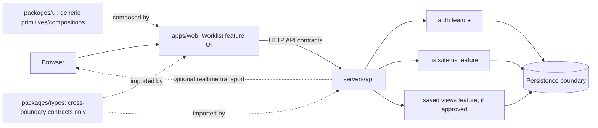

# Architecture Overview

**Version:** 0.3  
**Status:** Proposed baseline for review; not an approved final design  
**Owner:** [Your Name]  
**Reviewer:** Adeel  
**Last Updated:** 2026-10-14  
**Related Docs:** `01-context-and-scope.md`, `02-drivers-and-constraints.md`, `../system-design/04-api-contracts.md`

---

## 1. Purpose

Describe the proposed first-release structure at a level that allows product and engineering review without prematurely prescribing implementation details.

## 2. Current Repository Baseline (Observed)

- `apps/web` is a Next.js App Router application. `apps/web/features/worklist` owns registration/login UI, the authenticated list, query controls, columns, saved views, bulk actions, and virtualized rows.
- `servers/api` is an Express API with feature-owned auth, work-item, saved-view, and health capabilities. Authenticated operations scope data to the caller team.
- `servers/api/integrations/mongodb` owns the MongoDB/Mongoose connection. Auth, work-item, and saved-view features own their persistence models and repositories.
- `packages/ui` owns generic shadcn-based UI; `packages/types` owns cross-workspace API contracts.
- Repository control plane at `codebase/` handles workspace discovery and task orchestration and remains outside application feature scope.

## 3. Proposed v1 Shape

Start with the existing web app and API as a **modular application**, with feature ownership inside each runtime. Keep one deployable web app and one API unless an approved driver justifies additional runtimes. Use the existing database integration boundary if MongoDB is confirmed after reviewing data requirements.

The diagram shows ownership candidates, not completed modules. A saved-view feature or realtime transport should only be introduced when product scope and design decisions require it.

## 4. Ownership and Dependency Direction

- Web feature UI owns product-specific list interactions and view state.
- API feature owns request validation and application operations for its capability.
- Persistence operations stay behind feature-owned repository contracts; MongoDB details remain in the server integration/model boundary.
- Shared types are promoted to `packages/types` only when genuinely consumed across the web/API boundary.
- Generic UI primitives/compositions remain in `packages/ui`; list-specific UI stays app-owned.
- Feature modules expose controlled public entry points. Consumers do not deep-import another feature's internals.
- Dependencies point from delivery/UI toward application operations and from those operations toward explicit persistence/integration contracts.

## 5. Suggested Feature Growth

Start with the narrowest useful vertical slice (for example, authenticated list read/create/edit after identity and item ownership are agreed). Keep a feature flat until separate responsibilities become real. Add route/controller/service/repository/validation/model files only when each boundary has a distinct job. The repo's architecture rules prohibit empty role folders and speculative layers.

Potential server feature ownership may eventually include `auth` and `items` or `lists`; exact decomposition depends on whether users manage one shared list or multiple lists/workspaces.

## 6. Runtime Interaction

1. Browser loads the web app.
2. User action is validated at the UI boundary for usability.
3. API authenticates the caller, validates the request, checks authorization, and invokes the owning feature operation.
4. Feature operation applies business rules and calls its repository boundary.
5. API returns a stable response or machine-readable error.
6. If collaboration is approved, other clients receive a notification and fetch or apply the corresponding authorized change.

This is a conceptual flow; detailed failure branches belong in workflow design.

## 7. Alternatives and Trade-offs

| Option                                     | Benefits                                                                    | Costs / why not default now                                                                                           |
| ------------------------------------------ | --------------------------------------------------------------------------- | --------------------------------------------------------------------------------------------------------------------- |
| Modular web + API in existing workspace    | Matches current repo; clear ownership; one API boundary; simpler to operate | Requires disciplined feature boundaries; one API deploy scales as a unit                                              |
| Separate microservices per list capability | Independent deployment and scaling                                          | Adds network failure modes, data ownership complexity, and operations burden without a demonstrated team/scale driver |
| Web-only local persistence                 | Minimal server complexity                                                   | Does not satisfy shared team data, cross-device access, or centralized authorization goals                            |

The modular web/API baseline is the proposed starting point, pending review of drivers and deployment needs.

## 8. Architecture Decisions to Record

- Confirm product data store and data ownership model.
- Define list/workspace/team boundary and membership scope.
- Decide whether realtime is in v1 and choose its guarantees.
- Decide auth/session model and role/action policy.
- Define deployment, backup, restore, and observability expectations.

## 9. Open Questions

See `../decisions/README.md` for the decision backlog and owners.

## Architecture Lens Review

The proposed modular web/API shape follows the repository's feature-first ownership and explicit-boundary rules. Align boundaries with capabilities and data ownership; do not create services, packages, or role directories merely to represent a pattern. For each boundary identify responsibility, contract, dependency direction, failure behavior, and operational owner. Revisit only when an accepted driver justifies added complexity.

## 10. Change Log

| Date       | Version | Change                                                                           | Author                             |
| ---------- | ------- | -------------------------------------------------------------------------------- | ---------------------------------- |
| 2026-10-13 | 0.2     | Added subject-specific architecture-lens review guidance; decisions remain draft | Codex draft; owner review required |
| 2026-10-13 | 0.1     | Initial proposed architecture based on observed repo and draft goals             | Codex draft; owner review required |

## 10. Implemented Vertical Slice (2026-10-13)

The current implementation persists accounts, scrypt password verifiers, opaque server-side sessions, team-scoped work items, and private saved views in MongoDB. The web UI provides sign-up/sign-in; list CRUD, server-side search/filter/sort, grouping, column configuration, bulk operations, saved views, inline details, cursor paging, and viewport virtualization are implemented. Local browser/API origins use `localhost` so SameSite session cookies work consistently.

Remaining product/platform work includes provider-backed production deployment, Atlas backup/restore configuration, and monitoring/alert setup. F-18 realtime uses process-local server-sent refresh events and needs a shared event broker before horizontal scaling. F-20 telemetry currently emits minimized request logs but has no external dashboard. Multi-team accounts remain a v2 non-goal, and role-policy approval is still outstanding. The 10k-row and latency goals have not been benchmarked. This is an implementation snapshot, not approval of unresolved product policies.
---

**End of Document**
