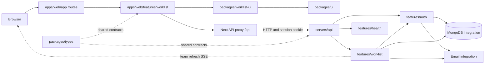

# Architecture Overview

**Version:** 0.4
**Status:** Implemented architecture snapshot; product policies remain draft
**Owner:** [Your Name]
**Reviewer:** Adeel
**Last Updated:** 2026-10-30
**Related Docs:** `01-context-and-scope.md`, `02-drivers-and-constraints.md`, `../system-design/04-api-contracts.md`

---

## 1. Purpose

Describe the current Worklist implementation and its module connections. Product policies and proposed future changes remain drafts unless an ADR says otherwise.

## 2. Current Repository Baseline (Observed)

- `apps/web` is a Next.js App Router application. Routes under `apps/web/app` select pages and the API proxy; `apps/web/features/worklist` owns Worklist state, API clients, feature components, permissions, and view logic.
- `packages/worklist-ui` owns reusable Worklist-specific views and controls (including List/Board, task details, filter dialog, and workspace shell). `apps/web` consumes it; the package depends on generic `packages/ui`, not on the app.
- `servers/api` is an Express API with feature-owned auth, worklist, and health capabilities. Authenticated operations scope data to the caller team.
- `servers/api/integrations/mongodb` owns the MongoDB/Mongoose connection. Auth, work-item, and saved-view features own their persistence models and repositories.
- `packages/ui` owns generic shadcn-based UI; `packages/types` owns cross-workspace API contracts where shared contracts exist.
- Repository control plane at `codebase/` handles workspace discovery and task orchestration and remains outside application feature scope.

## 3. Current Module Connections

The repository dependency graph keeps the web and API runtimes separate. The browser reaches the API through the Next.js proxy, while reusable UI packages flow upward into the web app.

The diagram shows ownership candidates, not completed modules. A saved-view feature or realtime transport should only be introduced when product scope and design decisions require it.

## 4. Ownership and Dependency Direction

- Web feature UI owns product-specific page state, data orchestration, and Worklist API calls. `packages/worklist-ui` owns reusable task views and controls; `packages/ui` stays product-agnostic.
- API features own request validation, authorization-aware application operations, and persistence orchestration for their capabilities.
- Persistence operations stay behind feature-owned repositories; MongoDB details remain in the server integration and feature model boundary.
- Shared types are promoted to `packages/types` only when genuinely consumed across the web/API boundary.
- Generic UI primitives/compositions remain in `packages/ui`; Worklist-specific reusable views live in `packages/worklist-ui`.
- Feature modules expose controlled public entry points. Consumers do not deep-import another feature's internals.
- Dependencies point from delivery/UI toward application operations and from those operations toward explicit persistence/integration contracts.

## 5. Feature Ownership and Structure

`apps/web/features/worklist` groups feature components, hooks, API clients, view state, and permissions. `packages/worklist-ui/src/components` contains reusable feature presentation. `servers/api/features/auth` handles accounts, sessions, team members, and invitations. `servers/api/features/worklist` owns HTTP routes/controllers, input validation, work item/list operations, repositories/models, assignment, comments, and activity. `servers/api/integrations` provides MongoDB and SMTP adapters. These stay feature-first and use controlled public entry points.

## 6. Runtime Interaction

1. Browser loads the web app.
2. User action is validated at the UI boundary for usability.
3. API authenticates the caller, validates the request, checks authorization, and invokes the owning feature operation.
4. Feature operation applies business rules and calls its repository boundary.
5. API returns a stable response or machine-readable error.
6. After a persisted change, team SSE refresh events tell connected clients to fetch authorized current data.

This is a conceptual flow; detailed failure branches belong in workflow design.

## 7. Alternatives and Trade-offs

| Option                                     | Benefits                                                                    | Costs / why not default now                                                                                           |
| ------------------------------------------ | --------------------------------------------------------------------------- | --------------------------------------------------------------------------------------------------------------------- |
| Modular web + API in existing workspace    | Matches current repo; clear ownership; one API boundary; simpler to operate | Requires disciplined feature boundaries; one API deploy scales as a unit                                              |
| Separate microservices per list capability | Independent deployment and scaling                                          | Adds network failure modes, data ownership complexity, and operations burden without a demonstrated team/scale driver |
| Web-only local persistence                 | Minimal server complexity                                                   | Does not satisfy shared team data, cross-device access, or centralized authorization goals                            |

The modular web/API shape is implemented. Deployment and product policy decisions remain subject to review of drivers and the decision log.

## 8. Architecture Decisions to Record

- Confirm product data store and data ownership model.
- Define list/workspace/team boundary and membership scope.
- Decide whether realtime is in v1 and choose its guarantees.
- Decide auth/session model and role/action policy.
- Define deployment, backup, restore, and observability expectations.

## 9. Open Questions

See `../decisions/README.md` for the decision backlog and owners.

## Architecture Lens Review

The proposed modular web/API shape follows the repository's feature-first ownership and explicit-boundary rules. Align boundaries with capabilities and data ownership; do not create services, packages, or role directories merely to represent a pattern. For each boundary identify responsibility, contract, dependency direction, failure behavior, and operational owner. Revisit only when an accepted driver justifies added complexity.

## 10. Change Log

| Date       | Version | Change                                                                           | Author                             |
| ---------- | ------- | -------------------------------------------------------------------------------- | ---------------------------------- |
| 2026-10-13 | 0.2     | Added subject-specific architecture-lens review guidance; decisions remain draft | Codex draft; owner review required |
| 2026-10-13 | 0.1     | Initial proposed architecture based on observed repo and draft goals             | Codex draft; owner review required |

## 10. Implemented Vertical Slice (2026-10-13)

The current implementation persists accounts, scrypt password verifiers, opaque server-side sessions, team-scoped Worklist data, invitations, comments, task activity, and saved views in MongoDB. The web UI provides account flows, list/workspace management, task CRUD, server-side search/filter/sort, grouping, configurable columns, bulk actions, saved views, task detail panels, cursor paging, and viewport virtualization. Assignee entry accepts email; owners can invite new addresses, and assigned members receive an email. A centered filter dialog and responsive Worklist views are provided by `packages/worklist-ui`. Local browser/API origins use `localhost` so SameSite session cookies work consistently.

Task workflow also includes checklists, dependencies, recurrence, labels, duplication, archive/restore, comments, activity, approvals, public client requests, reminders, templates, dashboard, and calendar capabilities. Team refresh uses process-local SSE and needs a shared broker before horizontal API scaling. Production deployment, Atlas backup/restore, monitoring and alerts need provider configuration. Multi-team accounts remain a v2 non-goal, and role-policy approval is outstanding. The 10k-row and latency goals have not been benchmarked. This snapshot records observed code, not approval of unresolved product policies.
---

**End of Document**
