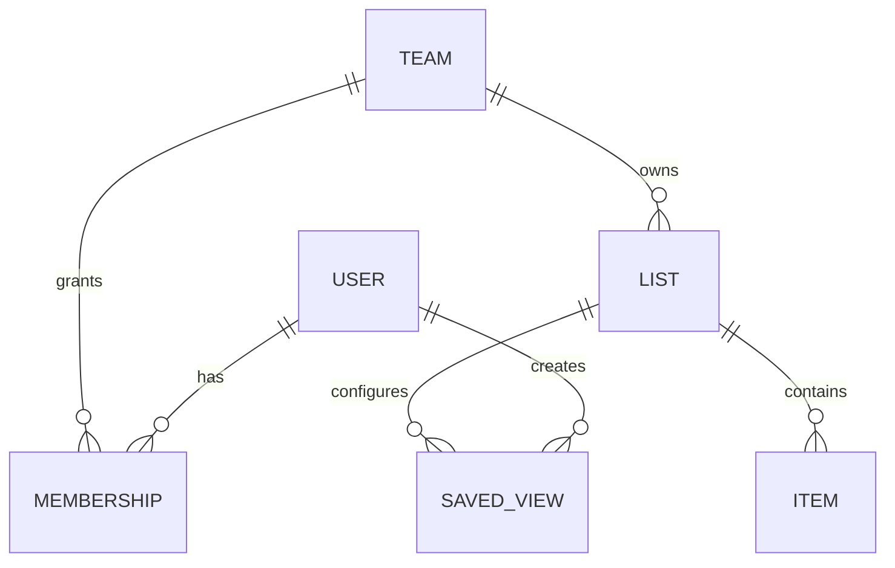

# List Data Model and Ownership

**Version:** 0.3  
**Status:** Draft for review  
**Owner:** [Your Name]  
**Reviewer:** Adeel  
**Last Updated:** 2026-10-13  
**Related Docs:** `../architecture/02-drivers-and-constraints.md`, `02-sort-filter-search-group.md`, `03-columns-and-saved-views.md`

---

## 1. Purpose

Describe candidate entities, ownership, relationships, and invariants before selecting collection schemas or indexes. This is a logical model, not a finalized MongoDB schema.

## 2. Candidate Entities

### Proposed v1 ownership baseline

Prefer a team-shared list over an isolated personal list because the product goals and primary persona emphasize shared team work and visibility. Treat this as a proposed product baseline, not an accepted architecture decision. For the first vertical slice, keep the ownership root explicit in the API and persistence contract. Whether that root is named team, workspace, or another container remains unresolved; avoid baking a final name into public contracts until it is decided.

| Entity                    | Candidate responsibility                     | Ownership / unresolved point                                  |
| ------------------------- | -------------------------------------------- | ------------------------------------------------------------- |
| User                      | Authenticated identity and account state     | Identity provider and user lifecycle are undecided            |
| Team or workspace         | Collaboration and access boundary            | Whether this exists in v1 is open                             |
| Membership                | Connects a user to a team/workspace and role | Role names and invitation lifecycle are open                  |
| List                      | Named container for work items and settings  | Number of lists and parent scope are open                     |
| Item                      | Work record with title and supported fields  | Owned by a list/team; exact fields are open                   |
| Saved view                | Named query and presentation configuration   | Private/shared scope and owner are open                       |
| Activity/event (optional) | Change history or realtime notification      | Do not add unless audit/history/realtime requirements need it |

## 3. Candidate Relationship

The `TEAM` relationship is provisional. If v1 supports only one personal list or a different sharing model, revise this diagram before implementing persistence.

## 4. Candidate Item Fields

From initial use cases, likely fields include:

- Stable item ID.
- Parent list/container ID.
- Title and optional description.
- Status.
- Optional due date.
- Optional assignee reference.
- Creation/update timestamps and actor references.
- A version or equivalent concurrency token if conflicting edits must be detected.

Attachments and custom fields are not confirmed v1 requirements. Checklists, same-list task dependencies, repeating tasks, comments, and task activity history are now implemented provisionally; these remain subject to product review.

### Implemented Item Fields (2026-10-14)

The current persisted item contains title, optional description, status, priority, free-form assignee, due date, team ownership, creator, and timestamps. It also stores checklist entries, same-list dependency IDs, and optional recurrence settings. Existing records without the newer fields serialize with safe empty/default values. Comments and activity history use separate team-scoped records; attachments and custom fields remain out of scope. This is an implementation snapshot, not an approved product contract.

## 5. Ownership and Invariants

Candidate invariants to confirm:

1. Every item belongs to exactly one list/container.
2. Every read and write is scoped to a resource the caller may access.
3. A saved view cannot disclose data beyond the caller's list permissions.
4. Item IDs are stable and not reused after deletion.
5. Updates use an explicit conflict policy so concurrent changes are not silently lost.
6. A bulk operation reports which items succeeded or failed if atomic all-or-nothing behavior is not provided.

## 6. Persistence Considerations

- Keep persistence operations behind feature-owned repositories; business rules should not depend directly on Mongoose documents.
- Use database indexes only for measured query shapes, tenant/list scoping, and approved sort/filter paths.
- Avoid exposing the storage document as the public API representation.
- Define deletion and retention behavior before choosing hard delete, soft delete, or archival.
- Transactions should cover only data owned by the same module and should not include network calls.

## 7. Open Questions

- What is the exact shared ownership root: team, workspace, project, or another container?
- Are multiple lists supported in v1?
- Which fields are built-in, and can users add custom fields?
- Is assignee a single user or can items have multiple collaborators?
- Are comments, attachments, history, and restore required?
- What is the concurrency/conflict policy?

## Data and Ownership Review Lens

For every persisted entity, confirm authoritative owner, lifecycle, access scope, and invariants. Model relationships so authorization can be enforced within the same scoped operation; never rely on the UI to restrict data. Define deletion, retention, and conflict behavior before selecting storage details. Keep optional entities out until a use case and owner justify them.

## 8. Change Log

| Date       | Version | Change                                                                              | Author                             |
| ---------- | ------- | ----------------------------------------------------------------------------------- | ---------------------------------- |
| 2026-10-13 | 0.3     | Recorded a proposed team-shared v1 ownership baseline; exact container remains open | Codex draft; owner review required |
| 2026-10-13 | 0.1     | Initial logical model; entity choices are provisional                               | Codex draft; owner review required |

## Implemented Baseline (Provisional)

The first slice uses a team as the ownership root. Account creation creates one team with the account as owner; each persisted work item stores that team ID, and repository reads/updates/deletes always include the authenticated team scope. Tasks support checklists, dependency links, and recurrence settings. Dependencies must point to another task in the same team/list, cannot form a cycle, and must be complete before the dependent task can be marked Done. Completing a repeating task creates its next occurrence with an idempotency index. Activity history records task creation, edits, comments, and deletion. These choices are provisional and require product-owner review before the design is treated as final.

---

**End of Document**

## Current implementation addendum (2026-10-14)

The implementation includes append-only comments and activity history in separate team-scoped collections. Comments store the task, team, author identity/name, body, and creation time. Activity entries store the task, team, actor, action summary, and time; the UI displays the latest 100 entries for a task. Authenticated team members can read history; owners and editors can add comments. Deleting a task removes its comments but preserves its history record. Attachments remain excluded. This is provisional, not a confirmed product requirement.

### Task lifecycle additions (2026-10-22)

Tasks now carry optional labels and an archive timestamp. Archive preserves task data and can be reversed by a team editor. Task duplication makes a new task in the same list and deliberately starts without dependency links or repeat settings; checklist entries are reset. These lifecycle choices are provisional.
