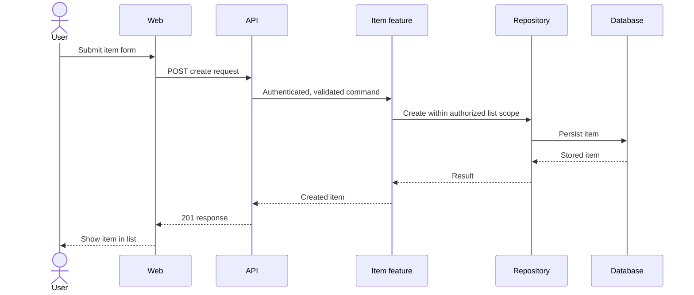

# Workflows and Failure Cases

**Version:** 0.2  
**Status:** Draft for review  
**Owner:** [Your Name]  
**Reviewer:** Adeel  
**Last Updated:** 2026-10-13  
**Related Docs:** `04-api-contracts.md`, `06-auth-and-permissions.md`, `07-performance-and-operations.md`

---

## 1. Purpose

Describe cross-component interactions, state transitions, and failure branches. Diagrams should show both successful and unsuccessful paths.

## 2. Create Item (Candidate Flow)

Failure branches to design: invalid input, expired identity, forbidden list, duplicate retry, database timeout, and response loss after persistence. A retry must not accidentally create duplicate items where idempotency is required.

## 3. Edit Item and Concurrent Changes

- Client submits a patch with the fields it intends to change and, if selected, the version it last read.
- API authenticates, authorizes, validates, and attempts a conditional update.
- If the version is stale, return a conflict or apply an explicitly approved merge rule.
- The UI explains the conflict and offers refresh/reapply behavior.

The conflict policy is not decided yet. Last-write-wins must not be assumed silently.

## 4. Bulk Operation

1. Client submits a bounded set of item IDs and an action.
2. API checks operation permission and access to every item.
3. API validates the action and request size.
4. Each item is processed according to chosen atomicity policy.
5. Response identifies overall outcome and per-item failures if partial success is possible.
6. UI refreshes affected rows and reports the result.

Open design choices: cross-page/all-filter selection, maximum batch size, all-or-nothing versus partial success, and retry semantics.

## 5. Query a List

The server authenticates the caller, scopes the query to authorized resources, validates query operators and fields, applies filters/search/sort/group, and returns a bounded page with stable continuation state. Failure or timeout must not be represented as a successful empty result.

## 6. Optional Realtime Update

If realtime is approved:

1. User A changes an item through the API.
2. The server commits the change.
3. A notification is published only after successful persistence.
4. Authorized connected clients receive a notification or re-fetch the changed item.
5. Clients deduplicate/reconcile delayed or repeated notifications and refetch after reconnect.

WebSocket is proposed in the feature draft but is not an approved transport. Define event identity, ordering, authorization at subscription time, reconnect, missed-event recovery, and consistency target before implementation.

## 7. Failure Matrix

| Failure                            | User-visible behavior                                         | Retry / recovery                                               |
| ---------------------------------- | ------------------------------------------------------------- | -------------------------------------------------------------- |
| Client offline before request      | Preserve unsent form state where safe and show offline status | Retry after connection returns; offline editing is not assumed |
| Request times out, outcome unknown | Do not claim success or failure without reconciliation        | Use idempotency/version token or fetch current state           |
| Validation fails                   | Point to invalid fields/conditions                            | User corrects request                                          |
| Access denied                      | Do not reveal protected record contents                       | No retry without permission change                             |
| Concurrent edit                    | Explain stale/conflicting update                              | Reload and reapply or resolve fields                           |
| Database unavailable               | Return retryable service error; avoid partial success claims  | Bounded retry/backoff policy at correct layer                  |
| Realtime disconnect                | Show stale/reconnecting state when needed                     | Reconnect and reconcile from authoritative API                 |
| Bulk partial failure               | Summarize succeeded/failed items                              | Allow retry of failed subset only if safe                      |

## 8. Invariants

- Authorization is checked on every request and every item in a bulk action.
- An event must not be announced as committed before the corresponding data change is durable.
- Retried mutations must follow an idempotency or conflict policy.
- Failure states must remain distinguishable from empty lists.

## 9. Open Questions

- Which workflows need sequence diagrams at implementation level?
- What retry policy applies to each operation?
- What conflict and partial-success semantics are acceptable?
- Is realtime required for v1?

## Reliability and Workflow Review

For each critical workflow review timeout, retry, duplicate delivery, authorization change, concurrent update, and dependency outage. Identify recovery ownership and user-visible state. An unknown mutation outcome requires reconciliation rather than an unsafe blind retry. Realtime notifications derive from committed state and need reconnect/recovery behavior if adopted.

## 10. Change Log

| Date       | Version | Change                                                                           | Author                             |
| ---------- | ------- | -------------------------------------------------------------------------------- | ---------------------------------- |
| 2026-10-13 | 0.2     | Added subject-specific architecture-lens review guidance; decisions remain draft | Codex draft; owner review required |
| 2026-10-13 | 0.1     | Initial workflows and failure branches                                           | Codex draft; owner review required |

---

**End of Document**

## Current implementation addendum (2026-10-14)

Bulk selection now includes a header control for currently loaded matching rows. If more than 100 rows are loaded, only the first 100 in current list order are selected and the UI states the cap. No unloaded task is included. Task comments are append-only, team-scoped, and removed when their parent task is deleted. See ADR-0002 for the provisional sharing and comment policy.

## Additional implementation update (2026-10-14)

Bulk updates now permit status, priority, assignee, or due date, one field at a time, for up to 100 explicit IDs; existing per-item failure reporting and retry selection are retained. Due-date comparisons use UTC date-only inputs and exclusive next-day boundaries. Successful comment creation publishes a team refresh event; open expanded comment panels then re-fetch from the API.
