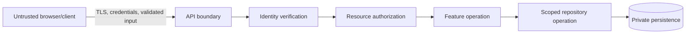

# Authentication and Permissions

**Version:** 0.5  
**Status:** Draft for review  
**Owner:** [Your Name]  
**Reviewer:** Adeel  
**Last Updated:** 2026-10-14  
**Related Docs:** `../architecture/01-context-and-scope.md`, `01-list-data-and-ownership.md`, `04-api-contracts.md`

---

## 1. Purpose

Describe the implemented identity/session baseline, trust boundaries, and remaining authorization decisions for protected list functionality.

## 2. Authentication vs Authorization

- **Authentication:** establish which user is making a request.
- **Authorization:** decide whether that user may perform this action on this resource.

A valid login does not imply access to every list or item. API operations must enforce authorization server-side; hiding a button in the web UI is not an access control.

## 3. Candidate Trust Boundaries

Treat client-supplied IDs, role names, filters, and visibility settings as untrusted. Recheck resource ownership/membership at the API boundary and constrain repository queries to the authorized scope.

## 4. Provisional Roles (Implemented; Product Policy Still Needs Review)

The initial feature list says role-based permissions but does not define roles. The API currently applies the owner/editor/viewer matrix below as a conservative v1 default. This implementation is provisional and does not mean Adeel or the product owner approved the policy. Team invitations, owner-only member listing, editor/viewer role changes, and member removal exist for the current one-team-per-user model. The action matrix is provisional and remains subject to product-owner review.

| Action                      | Owner | Editor | Viewer |
| --------------------------- | ----: | -----: | -----: |
| Read team items             |   Yes |    Yes |    Yes |
| Create, edit, delete items  |   Yes |    Yes |     No |
| Bulk update or delete items |   Yes |    Yes |     No |
| Invite editor/viewer        |   Yes |     No |     No |
| Own private saved views     |   Yes |    Yes |    Yes |
| Other users' private views  |    No |     No |     No |

## 5. Authentication Options to Evaluate

Email/password appears in the feature draft, but it does not define password storage, recovery, verification, session/token transport, expiry, refresh, CSRF, or account protection. Evaluate these as a coherent browser/API design before choosing JWT or cookie sessions. Do not store credentials or long-lived tokens in insecure browser storage.

### Recommended v1 starting point (proposed)

For a first-party browser application, prefer an opaque server-side session over a long-lived bearer token in browser storage:

- Generate a cryptographically random session token; store only its digest with the user, expiry, and revocation state.
- Send the raw token only in an HttpOnly cookie. Use Secure in production and choose SameSite/CORS/CSRF settings together with the actual deployment origins.
- Expire sessions and support logout/revocation. Require an Origin check or an equivalent CSRF defense for state-changing cookie-authenticated requests.
- If Worklist manages passwords locally, use a modern password-hashing function with a unique random salt and constant-time verifier comparison. Never log credentials or session tokens.
- If MongoDB is unavailable, fail protected operations closed; do not silently fall back to unauthenticated or in-memory shared data.

This provisional design is implemented in the current vertical slice. Deployment origin topology, account lifecycle, and the team membership/action matrix still need owner review.

## 6. Security Requirements (Candidate)

- Require TLS in deployed environments.
- Validate credentials and requests at boundaries; rate-limit sensitive auth operations.
- Store password verifiers using an approved modern password-hashing scheme if passwords are managed locally.
- Apply least privilege and deny by default.
- Scope reads, updates, deletes, bulk operations, and realtime subscriptions to authorized resources.
- Avoid leaking whether a protected resource exists where that would disclose sensitive information.
- Keep secrets out of source, client bundles, logs, and error responses.
- Record security-relevant events only with an approved privacy and retention policy.

## 7. Open Questions

- Local email/password or external identity provider?
- Cookie session or token model? What are expiry, revocation, refresh, CSRF, and XSS defenses?
- What is the membership container and role/action matrix?
- Are invitations, email verification, password recovery, MFA, SSO, or audit logs in scope?
- What privacy, retention, and account deletion rules apply?

## Security Lens and Verification

Use deny-by-default authorization and define a resource/action permission matrix before implementation. Apply the same authoritative policy to list queries, item operations, bulk actions, saved views, and realtime subscriptions. Threat review should cover session theft, cross-list access, query injection, enumeration, abuse, secret leakage, and sensitive logs. Test allowed and denied cases at server boundaries.

## Authentication Route Contract (2026-10-14)

| Route                | Access           | Behavior                                                      |
| -------------------- | ---------------- | ------------------------------------------------------------- |
| `/sign-in`           | Public           | Sign in with an existing Worklist account; link to `/sign-up` |
| `/sign-up`           | Public           | Register; email verification is required before sign-in       |
| `/forgot-password`   | Public           | Request a generic password-reset email response               |
| `/reset-password`    | Public           | Set a new password using a one-time token                     |
| `/verify-email`      | Public           | Verify or resend verification email                           |
| `/accept-invitation` | Public           | Accept invitation and create/join a single-team account       |
| `/worklist`          | Session required | Redirect unauthenticated visitors to `/sign-in`               |

Successful sign-in leads to `/worklist`. New registration sends a verification link and does not create a signed-in session until email verification is complete. Sign out clears the session cookie, revokes the stored session, and returns to `/sign-in`. Password recovery, verification/resend, and invitation acceptance have dedicated public routes. Owners can list members, change Editor/Viewer roles, and remove non-owner members; removal revokes active sessions. SMTP must be configured before email flows can send messages. Invited users join one team; multi-team accounts and owner transfer are not supported.

## 8. Email and Invitation Flows (Implemented; SMTP Required)

- Registration creates an unverified account and sends a one-day, single-use verification link. Existing accounts created before this field existed remain treated as verified for compatibility.
- Forgot-password responses do not confirm whether an account exists. Reset links expire after one day, are stored by token digest, and revoke all prior sessions after success.
- Owners may invite an unregistered email as an editor or viewer. Invitation links expire after seven days. Accepting an invitation verifies email ownership and creates the account in that team.
- Accounts belong to one team in this version. Existing registered users cannot join another team through an invitation; multi-team account support requires a separate data and session design.
- Configure `SMTP_HOST`, `SMTP_PORT`, `SMTP_USER`, `SMTP_PASSWORD`, and `EMAIL_FROM` together in `servers/api/.env`. Credentials must never be committed.

## 9. Change Log

| Date       | Version | Change                                                                          | Author                             |
| ---------- | ------- | ------------------------------------------------------------------------------- | ---------------------------------- |
| 2026-10-14 | 0.5     | Recorded public auth routes, protected Worklist route, and sign-out destination | Codex draft; owner review required |
| 2026-10-13 | 0.3     | Added a proposed server-side session baseline for the auth vertical slice       | Codex draft; owner review required |
| 2026-10-13 | 0.1     | Initial security and authorization draft; choices unapproved                    | Codex draft; owner review required |

## Implemented Baseline (Provisional)

Registration/login use a random opaque session token in an HttpOnly, SameSite=Lax cookie; MongoDB stores only its SHA-256 digest and expiry. Password verifiers use Node.js scrypt with a per-account random salt. Production cookies are marked Secure. Auth and item mutations enforce an allowed Origin, and item operations are scoped to the authenticated team. Action links for verification, password recovery, and invitation acceptance are random, expire, and are stored by digest; password reset revokes existing sessions. SMTP credentials are optional at server startup but required for account registration and email actions. Registration is limited to 5 attempts per IP per hour and login to 10 attempts per IP per 15 minutes using a process-local memory store; multi-instance deployment needs a shared store and trusted-proxy configuration. For local development, web and API URLs use the same hostname (`localhost`) so the browser sends the SameSite=Lax cookie. Role policy remains provisional; account deletion, multi-team accounts, owner transfer, production HTTPS/origin configuration, and member administration remain outstanding. This implementation does not approve the full security policy.

---

**End of Document**
