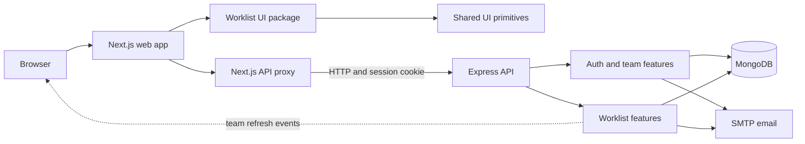

# Worklist

**A shared workspace for planning work, keeping teams aligned, and seeing what needs attention.**

Worklist is a team work-management application with list, board, and calendar views. Create and organize tasks, assign work by email, track progress and dependencies, and coordinate through comments, approvals, and live workspace refreshes.

> Product direction and architecture notes are documented under [`.project/worklist`](.project/worklist/README.md). Some permissions and product policies remain provisional; see the [decision log](.project/worklist/decisions/README.md).

## What you can do

- Plan work in **List, Board, and Calendar** views with search, filters, sorting, grouping, saved views, and configurable columns.
- Organize tasks with priorities, labels, checklists, dependencies, due dates, recurring work, and archive/restore.
- Assign tasks using a teammate's email. Workspace owners can invite a new address; assignment emails include a link back to Worklist.
- Keep task context together with comments and an activity timeline.
- Coordinate workspaces with dashboards, reusable task templates, public client request forms, and approval links.
- Import and export task data, including JSON backup/restore and CSV export of loaded results.

## Screens and architecture



The main workspaces are:

| Path | Responsibility |
| --- | --- |
| [`apps/web`](apps/web) | Next.js pages, feature state, API client, and application experience |
| [`servers/api`](servers/api) | Express API, authentication, Worklist operations, and integrations |
| [`packages/worklist-ui`](packages/worklist-ui) | Reusable Worklist views, task controls, and workspace presentation |
| [`packages/ui`](packages/ui) | Generic shadcn-based UI primitives and compositions |
| [`packages/types`](packages/types) | Shared cross-workspace API contracts |
| [`.project/worklist`](.project/worklist/README.md) | Product, architecture, system design, operations, and decisions |

For the detailed frontend-to-backend request flow and module ownership, see the [architecture overview](.project/worklist/architecture/03-architecture-overview.md). Repository-wide rules are in [`AGENTS.md`](AGENTS.md) and [`architecture.yaml`](architecture.yaml).

## Run locally

### Requirements

- Node.js 22 or later
- pnpm 11.19.0
- A reachable MongoDB instance for account and Worklist data

Install dependencies from the repository root:

```bash
pnpm install
```

Set up local environment files:

1. Copy [`servers/api/.env.example`](servers/api/.env.example) to `servers/api/.env` and set `MONGODB_URI`.
2. If needed, copy [`apps/web/.env.example`](apps/web/.env.example) to `apps/web/.env.local` and set the API URL.
3. Configure SMTP in the API environment to enable verification, invitations, and task assignment emails.

Start the development web app and API from the repository root:

```bash
pnpm run dev
```

The API can start without MongoDB, but persistent account and Worklist operations remain unavailable until the database connection is ready. See [local setup and implementation status](.project/worklist/README.md#9-local-setup-required) and the [production readiness notes](.project/worklist/operations/01-production-readiness.md) for more.

## Use Worklist

1. Open `http://localhost:3000` after the development servers start.
2. Create an account from **Sign up**. Registration sends an email verification link; configure SMTP first if you want verification and account emails delivered. You can also sign in with an existing account.
3. Create a List, then add tasks with a title, description, status, priority, dates, labels, and optional checklist or dependencies.
4. Enter a teammate's email in **Assignee**. An existing workspace member is assigned directly; a new address is invited by the workspace owner. Assignment and invitation email delivery requires SMTP configuration.
5. Switch between List, Board, and Calendar; use search and filters to find work, and save a view to keep its filter, sort, grouping, and columns.
6. Open a task to add comments, review activity, manage dependencies/checklists, or archive and restore it. Use Dashboard for team progress, and workspace settings for members and templates.

The API health endpoint is available at `http://localhost:4000/health`; readiness at `/ready` reports whether MongoDB is connected. The detailed [use cases](.project/worklist/product/05-use-cases.md), [API behavior](.project/worklist/system-design/04-api-contracts.md), and [auth/permission rules](.project/worklist/system-design/06-auth-and-permissions.md) explain edge cases and current access boundaries.

### Local email and database setup

- **MongoDB:** Set `MONGODB_URI` in `servers/api/.env` to a reachable local MongoDB or Atlas database. Without it, the API starts but persistent Worklist actions return service unavailable.
- **Email:** Set `SMTP_HOST`, `SMTP_PORT`, `SMTP_USER`, `SMTP_PASSWORD`, and `EMAIL_FROM` together in `servers/api/.env`. Email features stay unavailable until all values are valid.
- **Web/API origins:** The default web URL is `http://localhost:3000`; the API listens on `http://127.0.0.1:4000`. The web app uses its `/api` proxy, so normal local use does not need a public API URL.
- **Never commit credentials:** Keep real values only in ignored `.env`/`.env.local` files. The checked-in `.env.example` files contain safe placeholders.

## Validate changes

```bash
pnpm run check       # repository and architecture policy
pnpm run typecheck   # TypeScript across the workspace
pnpm run lint        # ESLint across the workspace
pnpm run test        # control-plane and workspace tests
pnpm run build       # production builds
pnpm run scan        # dependency audit and secret scan
pnpm run validate    # complete validation pipeline
```

`pnpm run scan` contacts the configured package registry for the dependency audit and uses the repository-managed TruffleHog release for secret detection.

## Project documentation

- [Project guide and implementation status](.project/worklist/README.md)
- [Product vision](.project/worklist/product/01-vision.md) · [features](.project/worklist/product/06-features.md) · [roadmap](.project/worklist/product/07-roadmap.md)
- [Architecture context](.project/worklist/architecture/01-context-and-scope.md) · [drivers](.project/worklist/architecture/02-drivers-and-constraints.md) · [architecture overview](.project/worklist/architecture/03-architecture-overview.md)
- [API contracts](.project/worklist/system-design/04-api-contracts.md) · [workflows and failure cases](.project/worklist/system-design/05-workflows-and-failure-cases.md) · [auth and permissions](.project/worklist/system-design/06-auth-and-permissions.md)
- [Production readiness](.project/worklist/operations/01-production-readiness.md) · [architecture decisions](.project/worklist/decisions/README.md)

## Current limits

- Team refresh events and default rate-limit state are process-local; multi-instance deployments need shared infrastructure.
- Production hosting, SMTP credentials, database backup policy, monitoring, and restore drills need environment-specific setup.
- Performance targets have not been benchmarked at large task counts.
- Membership, sharing, and role policies remain subject to product review.

Do not commit `.env` files, API secrets, SMTP credentials, database connection strings, or real user data.
